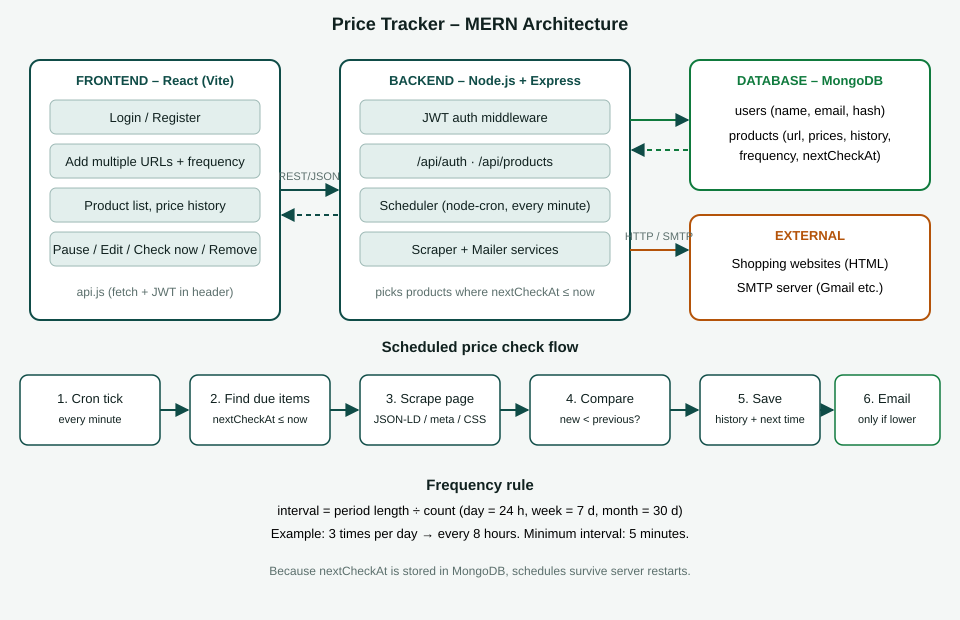
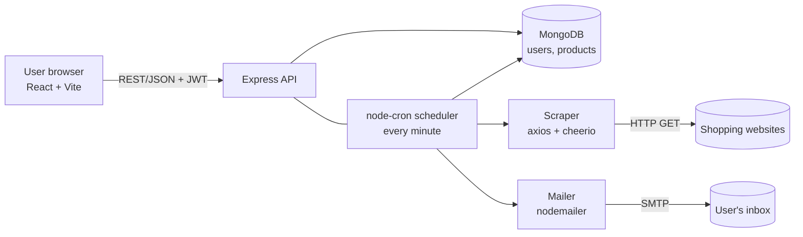
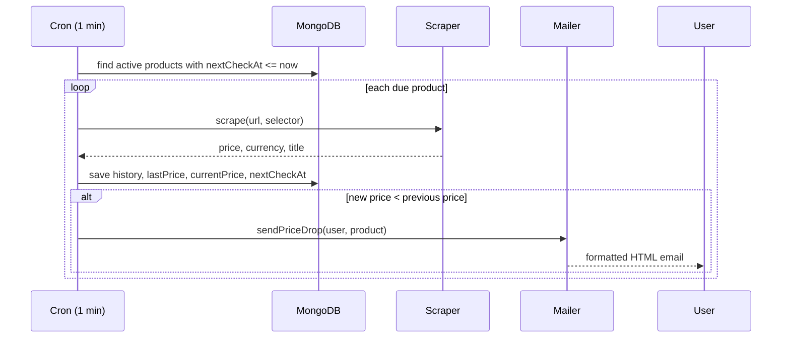

# Architecture

## System overview

## Price-check sequence

## Data model
- **User**: name, email (unique), password (bcrypt hash)
- **Product**: user, url, title, selector, currency, currentPrice, lastPrice, lowestPrice,
  frequency{count, period}, active, nextCheckAt, lastCheckedAt, lastError, history[{price, at}]

## API
| Method | Path | Purpose |
|---|---|---|
| POST | /api/auth/register, /login | create account / sign in |
| GET | /api/auth/me | current user |
| GET | /api/products | list my products |
| POST | /api/products | add many URLs {urls[], frequency{count,period}, selector?} |
| PATCH | /api/products/:id | change frequency, pause/resume, selector |
| POST | /api/products/:id/check | check right now |
| DELETE | /api/products/:id | stop tracking |
